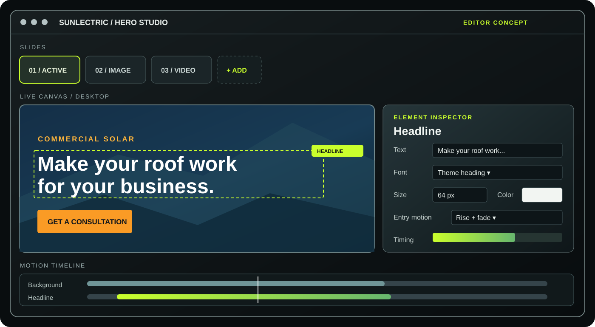
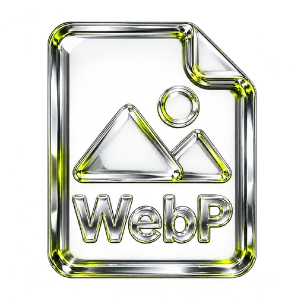

# Sunlectric Solar WordPress

<strong>COMMERCIAL SOLAR &nbsp; / &nbsp; WORDPRESS &nbsp; / &nbsp; VERSION 1.10.1</strong>

  <a href="https://rawpowered.github.io/Sunlectric-Solar-WordPress-Showcase/"><strong>Case study</strong></a> &nbsp; · &nbsp;
  <a href="demo.html"><strong>One-page preview</strong></a> &nbsp; · &nbsp;
  <a href="demo-multipage.html"><strong>Multi-page preview</strong></a> &nbsp; · &nbsp;
  <a href="https://github.com/RawPowered"><strong>Contact</strong></a>

A commercial solar WordPress theme by <strong>Joseph Edwards (RawPowered)</strong>. A photographic customer experience meets a custom visual studio for the homepage hero.

<table>
  <tr>
    <td width="33%" align="center"><strong>Visual hero editing</strong> Slides, media, text, buttons, and motion</td>
    <td width="33%" align="center"><strong>Responsive presentation</strong> Desktop, mobile, one-page, and multi-page</td>
    <td width="33%" align="center"><strong>Theme-wide controls</strong> Fonts, colors, logos, header, contact, and map</td>
  </tr>
</table>

## See the site in motion

<small>Animated from the October 28, 2026 static HTML capture. Click to open the interactive page preview. The hosted WordPress lab uses different Hero Studio copy and slide settings.</small>

## Explore the experience

<table>
  <tr>
    <td width="66%" align="center"> <strong>Desktop</strong> · <a href="docs/previews/desktop.jpg">Full-page capture</a></td>
    <td width="34%" align="center"> <strong>Mobile</strong> · <a href="docs/previews/mobile.jpg">Full-page capture</a></td>
  </tr>
</table>

| Preview | What it shows |
| --- | --- |
| [One-page solar site](demo.html) | Hero, services, project story, questions, and consultation path |
| [Multi-page solar site](demo-multipage.html) | Homepage with separate About Us and Contact Us pages |
| [About Us](about.html) | Company story and editorial page layout |
| [Contact Us](contact.html) | Inquiry layout and optional OpenStreetMap placement |

<table>
  <tr><td width="50%" align="center"> <strong>About Us</strong></td><td width="50%" align="center"> <strong>Contact Us</strong></td></tr>
</table>

<strong>View footer map options</strong>

 

The captures above document the repository's responsive HTML representation of the theme. The charcoal, lime, and glass framing belongs to this RawPowered case study; the solar website has its own navy, gold, orange, and blue identity.

## Hero Studio

<small>Editor layout illustration. This is not a WordPress Admin screenshot.</small>

**Appearance → Hero Studio** manages the bundled WordPress homepage hero. The editor supports up to eight slides; three are enabled in the starter setup.

| Control | Capability |
| --- | --- |
| Slide strip | Select, add, remove, and preview image or video slides |
| Element inspector | Edit eyebrow, headline, supporting text, two buttons, and background separately |
| Typography | Inherit theme or hero fonts, or choose a custom family. Set headline size for desktop and mobile, weight, line height, letter spacing, and color |
| Media and overlay | Choose a still image or muted MP4/WebM video with image poster; adjust overlay type, color, and opacity |
| Motion timeline | Set slide transitions, layer entry and exit styles, delay and duration; reset the stagger when needed |
| Playback | Choose slideshow or a single static slide, autoplay timing, navigation, pause control, and subtle desktop parallax |
| Preview | Check desktop, mobile, and full-screen playback before saving |

Reduced-motion preferences suppress decorative transitions and automatic playback. The first hero slide is rendered in HTML before the front-end script runs. An Elementor-built homepage manages its own hero content.

## Theme options

| Area | Settings |
| --- | --- |
| Presentation | One scrolling page or a multi-page site with About Us and Contact Us |
| Typography | Site body, heading, and navigation fonts, including selected Google Fonts |
| Brand colors | Main palette and header colors |
| Header and menu | Main, scrolled, and mobile logos; sticky header, scroll shrink, and menu transitions |
| Contact | Form recipient and preview mode until a recipient is configured |
| Map | Keyless OpenStreetMap on Contact Us or above every page footer |

The Denver map point is an example. The theme includes [OpenStreetMap attribution](https://www.openstreetmap.org/copyright). The contact form sends through WordPress mail and does not store submissions in the site database; delivery depends on the host's mail setup.

## Build and compatibility

<table>
  <tr>
    <td align="center" width="33%"> <strong>WordPress 6.4+</strong> Theme templates and settings</td>
    <td align="center" width="33%"> <strong>PHP 7.4+</strong> Server-rendered homepage</td>
    <td align="center" width="33%"> <strong>JavaScript</strong> Hero Studio and front-end interactions</td>
  </tr>
  <tr>
    <td align="center"> <strong>HTML5</strong> Page structure</td>
    <td align="center"> <strong>CSS3</strong> Responsive layouts</td>
    <td align="center"> <strong>WebP</strong> Compressed theme imagery</td>
  </tr>
</table>

The starter layouts run with WordPress core. Free Elementor is optional for a separately built homepage. Below-the-fold photos load lazily; the first hero image loads eagerly. Theme asset URLs use file-specific cache versions so editor CSS and JavaScript update together.

**Hosted check, October 30, 2026:** Version 1.10.1 was installed on a WordPress 7.1.4 lab. The full-width Hero Studio, slide strip, element inspector, timeline, desktop and mobile previews, and three-slide homepage rendered successfully. The browser reported no console errors. The lab URL remains internal to testing.

## Availability

This public repository contains a case study and static HTML previews. The installable WordPress theme and PHP source are maintained in a separate private repository. Contact [Joseph Edwards](https://github.com/RawPowered) for access and terms.

The solar photographs are generic commercial stock. The previews contain no production database, credentials, submissions, or client uploads. Contact actions in the HTML preview do not submit information.
