# Sunlectric Solar WordPress

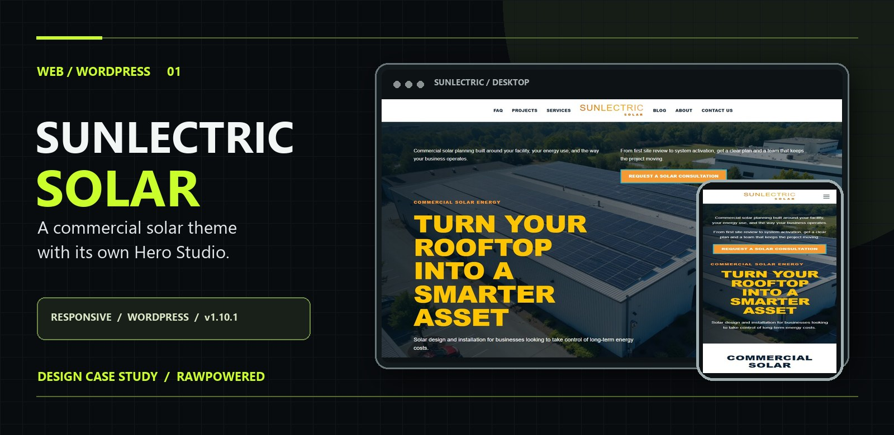

<strong>COMMERCIAL SOLAR &nbsp; / &nbsp; WORDPRESS &nbsp; / &nbsp; VERSION 1.10.1</strong>

  <a href="https://rawpowered.github.io/Sunlectric-Solar-WordPress-Showcase/"><strong>Case study</strong></a> &nbsp; · &nbsp;
  <a href="demo.html"><strong>One-page preview</strong></a> &nbsp; · &nbsp;
  <a href="demo-multipage.html"><strong>Multi-page preview</strong></a> &nbsp; · &nbsp;
  <a href="https://github.com/RawPowered"><strong>Contact</strong></a>

A commercial solar WordPress theme by <strong>Joseph Edwards (RawPowered)</strong>. Its bundled Hero Studio gives site owners direct control over the homepage's slides, media, copy, design, and motion.

<table>
  <tr>
    <td width="33%" align="center"><strong>Bundled Hero Studio</strong> No separate slider plugin needed for the theme homepage</td>
    <td width="33%" align="center"><strong>Responsive presentation</strong> Desktop, mobile, one-page, and multi-page</td>
    <td width="33%" align="center"><strong>Theme-wide controls</strong> Fonts, colors, logos, header, contact, and map</td>
  </tr>
</table>

## See the site in motion

<a href="demo.html">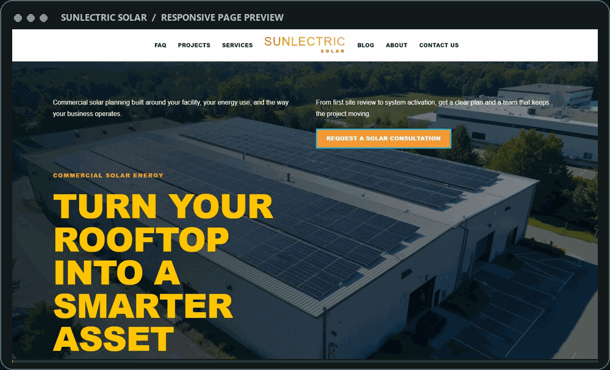</a>

<small>Animated from the October 28, 2026 static HTML capture. Click to open the interactive page preview. The hosted WordPress lab uses different Hero Studio copy and slide settings.</small>

## Explore the experience

<table>
  <tr>
    <td width="66%" align="center"> <strong>Desktop</strong> · <a href="docs/previews/desktop.jpg">Full-page capture</a></td>
    <td width="34%" align="center"> <strong>Mobile</strong> · <a href="docs/previews/mobile.jpg">Full-page capture</a></td>
  </tr>
</table>

| Preview | What it shows |
| --- | --- |
| [One-page solar site](demo.html) | Hero, services, project story, questions, and consultation path |
| [Multi-page solar site](demo-multipage.html) | Homepage with separate About Us and Contact Us pages |
| [About Us](about.html) | Company story and editorial page layout |
| [Contact Us](contact.html) | Inquiry layout and optional OpenStreetMap placement |

<table>
  <tr><td width="50%" align="center"><a href="docs/previews/about.jpg">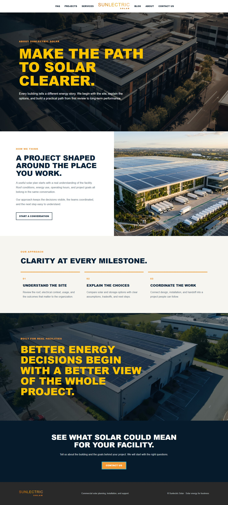</a> <strong>About Us</strong></td><td width="50%" align="center"><a href="docs/previews/contact.jpg">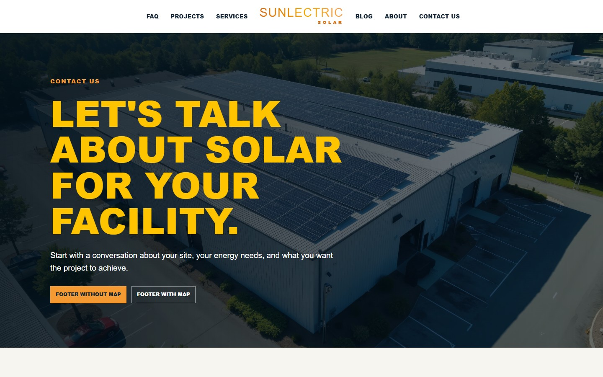</a> <strong>Contact Us</strong></td></tr>
</table>

<strong>View footer map options</strong>

 <a href="docs/previews/footer-with-map.jpg">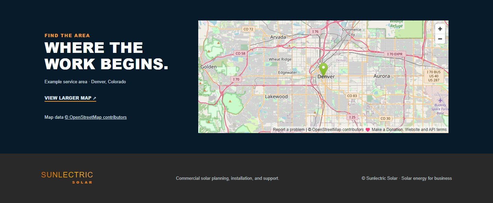</a>

The captures above document the repository's responsive HTML representation of the theme. The charcoal, lime, and glass framing belongs to this RawPowered case study; the solar website has its own navy, gold, orange, and blue identity.

## Hero Studio

<a href="docs/previews/admin/hero-studio-canvas.webp">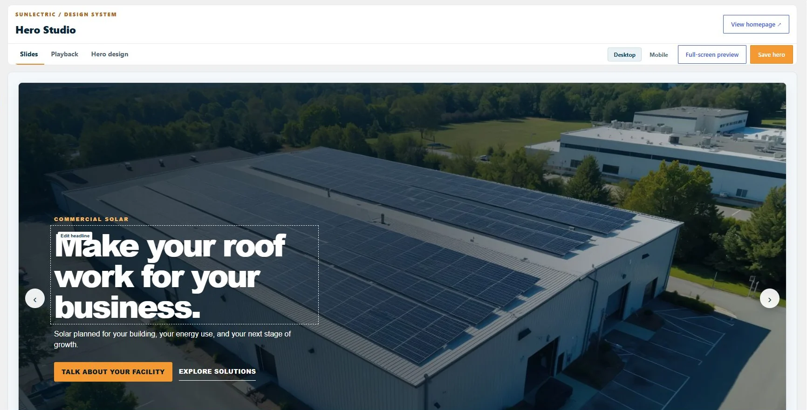</a>

<small>Actual Hero Studio in the local WordPress theme lab, captured October 30, 2026.</small>

### A built-in visual editor for the most visible part of the site

**Appearance → Hero Studio** manages the theme's bundled homepage hero. Site owners can build an image or video slideshow with tailored copy and calls to action, then see the result before publishing. These controls ship with Sunlectric. The bundled homepage does not need a separately purchased slider or an additional slider plugin to use them.

<small>Three actual WordPress slide captures assembled with crossfades for README playback. This is not a continuous screen recording.</small>

<table>
  <tr>
    <td width="33%" align="center"><a href="docs/previews/admin/live-slide-1.webp">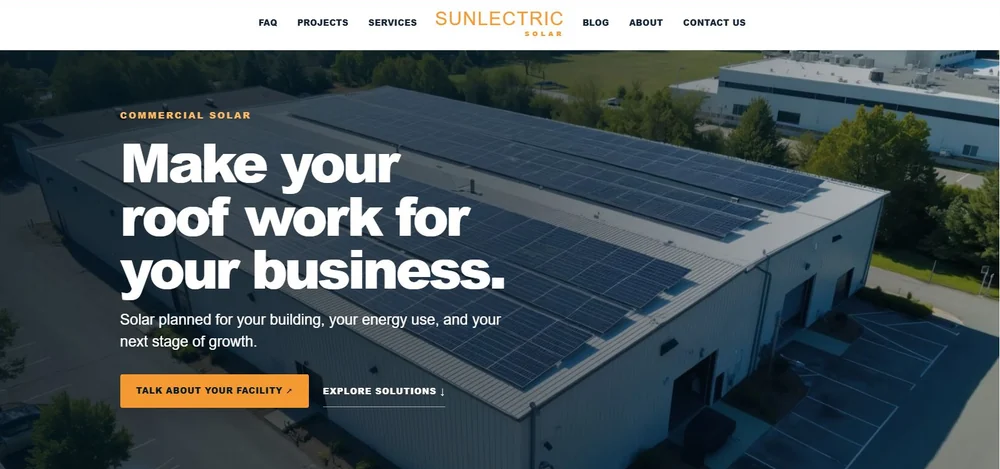</a> <strong>01 / Commercial solar</strong></td>
    <td width="33%" align="center"> <strong>02 / Energy planning</strong></td>
    <td width="33%" align="center"><a href="docs/previews/admin/live-slide-3.webp">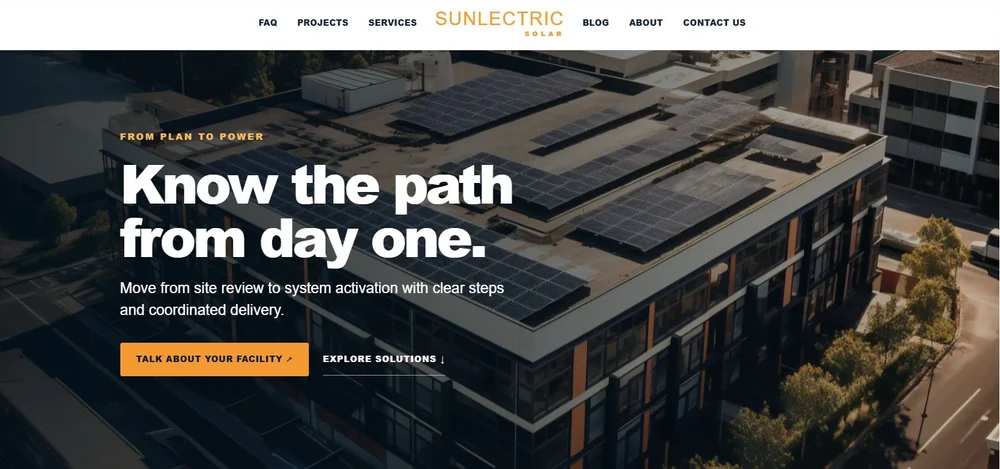</a> <strong>03 / Project path</strong></td>
  </tr>
</table>

<table>
  <tr>
    <td width="33%" align="center"><strong>Build the story</strong> Up to eight slide slots, with three enabled in the starter setup</td>
    <td width="33%" align="center"><strong>Shape the look</strong> Media, overlays, typography, layout, and two buttons per slide</td>
    <td width="33%" align="center"><strong>Direct the motion</strong> Transitions, layer timing, autoplay, and playback controls</td>
  </tr>
</table>

The workspace keeps the slide strip, live canvas, selected element controls, and motion timeline together. Click a layer to edit it; hide a layer without deleting its copy. Desktop and mobile views update as settings change, and full-screen preview plays the draft slideshow before it is saved.

### Inside the editor

<table>
  <tr>
    <td width="50%" align="center"><a href="docs/previews/admin/hero-studio-slides.webp">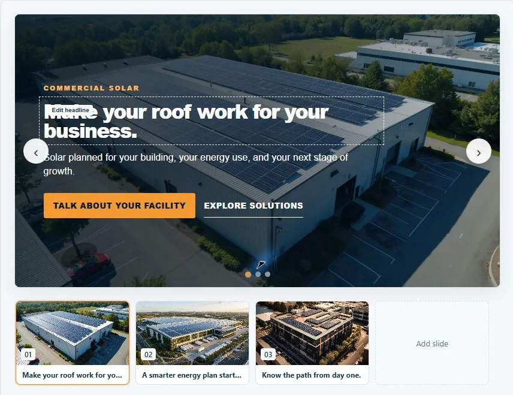</a> <strong>Slide workspace</strong></td>
    <td width="50%" align="center"><a href="docs/previews/admin/hero-studio-inspector.webp">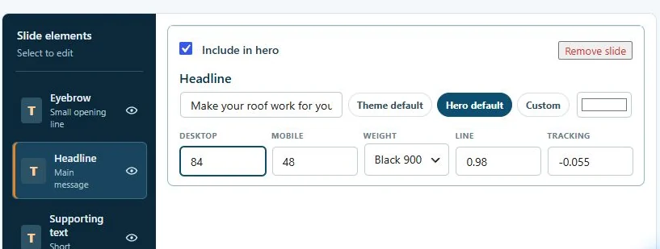</a> <strong>Layer inspector</strong></td>
  </tr>
  <tr>
    <td align="center"><a href="docs/previews/admin/hero-studio-timeline.webp">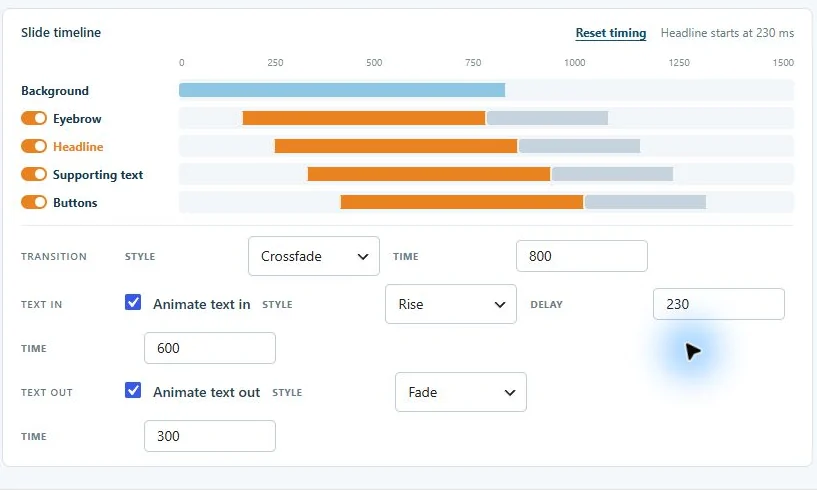</a> <strong>Motion timeline</strong></td>
    <td align="center"><a href="docs/previews/admin/hero-studio-video-controls.webp">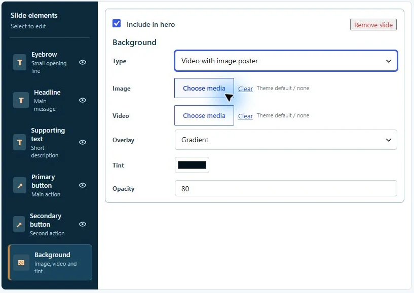</a> <strong>Image and video media</strong></td>
  </tr>
  <tr>
    <td align="center"><a href="docs/previews/admin/hero-studio-playback.webp">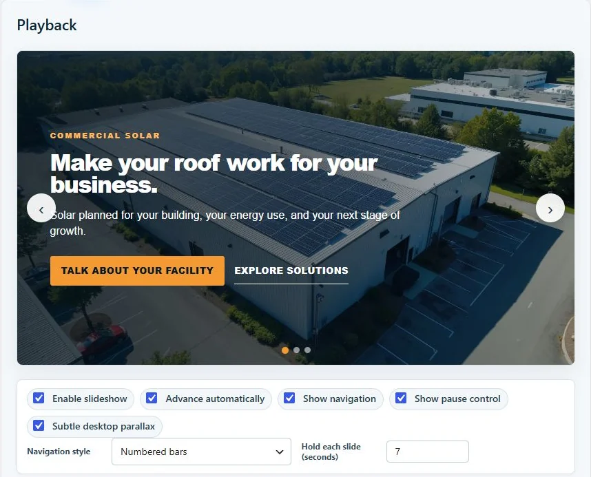</a> <strong>Playback</strong></td>
    <td align="center"><a href="docs/previews/admin/hero-studio-design.webp">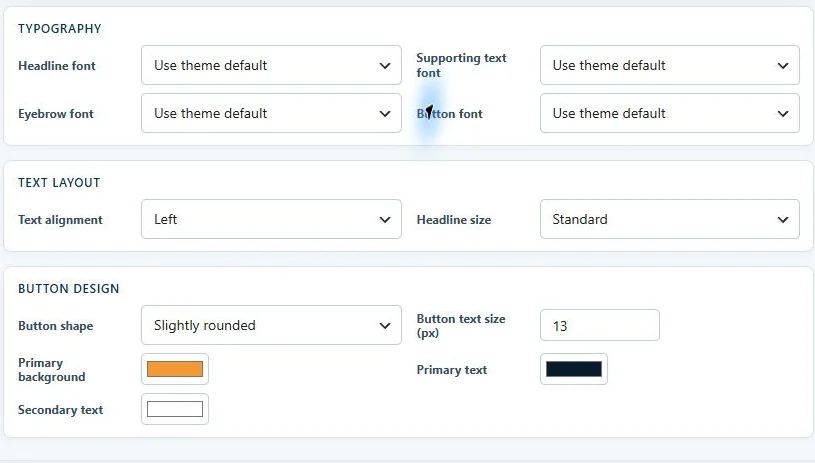</a> <strong>Hero design</strong></td>
  </tr>
</table>

<small>Captured from the local WordPress Admin on October 30, 2026. Images are cropped for readability.</small>

| Design area | Controls available now |
| --- | --- |
| **Slides and media** | Add, remove, enable, and select slides. Use a still image or muted MP4/WebM video; the image serves as the video poster and fallback. |
| **Copy and actions** | Edit the eyebrow, headline, supporting text, and two buttons for each slide. Set each button's label and destination; choose button shape, size, font, and colors in the shared hero design controls. |
| **Type and color** | Inherit the site's fonts, use a hero font, or choose a slide font. Adjust headline scale for desktop and mobile, weight, line height, letter spacing, and text color. Set the hero's text alignment. |
| **Overlays** | Choose gradient, even tint, vignette, or no overlay. Set overlay color and opacity to keep text readable over different imagery. |
| **Transitions** | Crossfade, lateral slide, rise, soft zoom, curtain reveal, or instant, with a 300-2000 ms transition duration. |
| **Layer animation** | Give the background and text layers their own entry and exit styles, start times, and durations. Drag timeline bars or enter values; reset the stagger when needed. |
| **Playback** | Run a slideshow or one static image or video. Set a 4-12 second slide hold, autoplay, numbered bars/dots/arrows, a pause control, and subtle desktop parallax. |
| **Preview and publish** | Review unsaved changes on desktop, mobile, or in a full-screen modal; save when the composition is ready. |

The first slide is server-rendered in HTML, so the headline and initial visual remain available before JavaScript runs. Reduced-motion preferences suppress decorative motion and automatic playback. The live editor is part of this theme; an Elementor-built homepage manages its own hero separately.

Hero Studio is an actively developed part of Sunlectric. Future releases can expand the editor, while the table above describes the controls included in **v1.10.1**.

## Theme options

<a href="docs/previews/admin/customizer-overview.webp">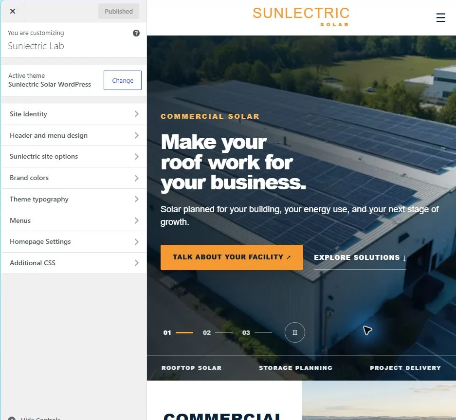</a>

<small>Sunlectric settings in the local WordPress Customizer, captured October 30, 2026.</small>

<table>
  <tr>
    <td width="25%" align="center"><a href="docs/previews/admin/customizer-header.webp">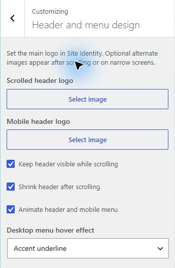</a> <strong>Header and menu</strong></td>
    <td width="25%" align="center"><a href="docs/previews/admin/customizer-colors.webp">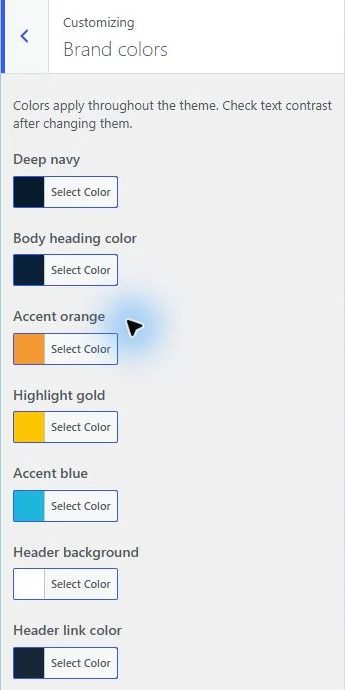</a> <strong>Brand colors</strong></td>
    <td width="25%" align="center"><a href="docs/previews/admin/customizer-typography.webp">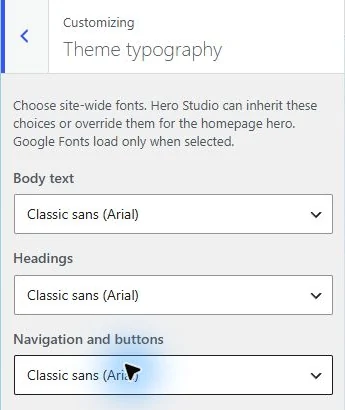</a> <strong>Typography</strong></td>
    <td width="25%" align="center"><a href="docs/previews/admin/customizer-site-options.webp">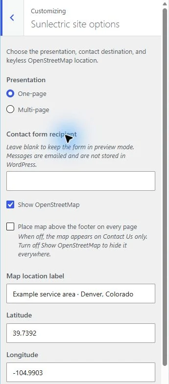</a> <strong>Site options</strong></td>
  </tr>
</table>

| Area | Settings |
| --- | --- |
| Presentation | One scrolling page or a multi-page site with About Us and Contact Us |
| Typography | Site body, heading, and navigation fonts, including selected Google Fonts |
| Brand colors | Main palette and header colors |
| Header and menu | Main, scrolled, and mobile logos; sticky header, scroll shrink, and menu transitions |
| Contact | Form recipient and preview mode until a recipient is configured |
| Map | Keyless OpenStreetMap on Contact Us or above every page footer |

The Denver map point is an example. The theme includes [OpenStreetMap attribution](https://www.openstreetmap.org/copyright). The contact form sends through WordPress mail and does not store submissions in the site database; delivery depends on the host's mail setup.

## Build and compatibility

<table>
  <tr>
    <td align="center" width="33%"> <strong>WordPress 6.4+</strong> Theme templates and settings</td>
    <td align="center" width="33%"> <strong>PHP 7.4+</strong> Server-rendered homepage</td>
    <td align="center" width="33%"> <strong>JavaScript</strong> Hero Studio and front-end interactions</td>
  </tr>
  <tr>
    <td align="center"> <strong>HTML5</strong> Page structure</td>
    <td align="center"> <strong>CSS3</strong> Responsive layouts</td>
    <td align="center"> <strong>WebP</strong> Compressed theme imagery</td>
  </tr>
</table>

The starter layouts run with WordPress core. Free Elementor is optional for a separately built homepage. Below-the-fold photos load lazily; the first hero image loads eagerly. Theme asset URLs use file-specific cache versions so editor CSS and JavaScript update together.

**Hosted check, October 30, 2026:** Version 1.10.1 was installed on a WordPress 7.1.4 lab. The full-width Hero Studio, slide strip, element inspector, timeline, desktop and mobile previews, and three-slide homepage rendered successfully. The browser reported no console errors. The lab URL remains internal to testing.

## Availability

This public repository contains a case study and static HTML previews. The installable WordPress theme and PHP source are maintained in a separate private repository. Contact [Joseph Edwards](https://github.com/RawPowered) for access and terms.

The solar photographs are generic commercial stock. The previews contain no production database, credentials, submissions, or client uploads. Contact actions in the HTML preview do not submit information.
