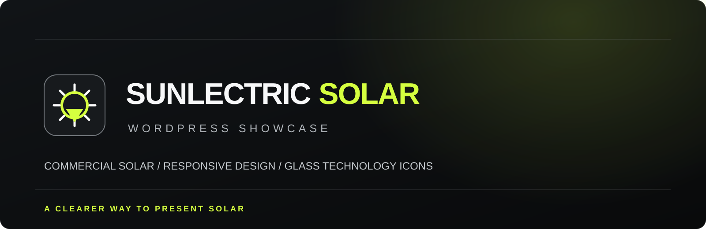
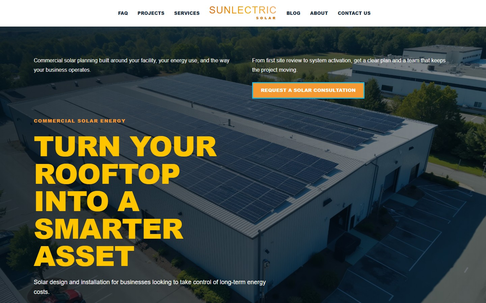
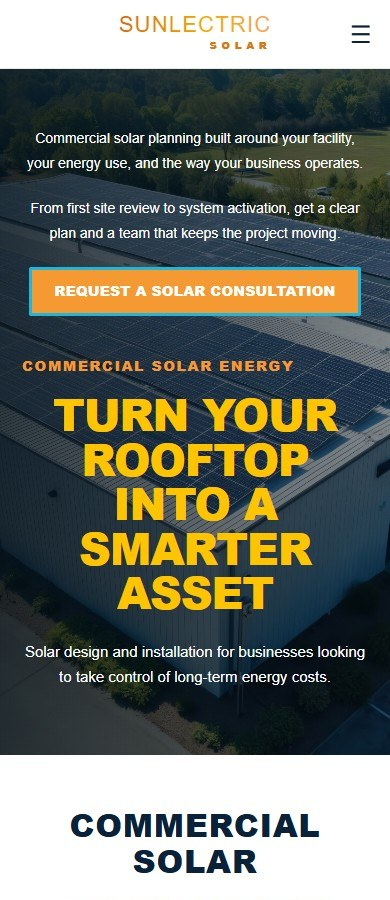

  

<strong>THE FIRST SCREEN / SUNLECTRIC SOLAR</strong>

  

<strong>FULL-PAGE PREVIEW / DESKTOP + MOBILE</strong>

  
  

<a href="index.html">View the showcase</a> · <a href="demo.html">Explore the one-page preview</a> · <a href="demo-multipage.html">Explore the multi-page preview</a>

# Sunlectric Solar WordPress

Sunlectric is a responsive commercial solar WordPress theme by **Joseph Edwards (RawPowered)**. It keeps the solar site’s dark photographic hero, gold headings, orange actions, centered split menu, and alternating editorial sections. The lime and glass visual system belongs to this case-study presentation; the theme preview retains its own solar identity.

This is a cleaned-up, rebranded showcase adaptation of the WordPress build used for Sunprise.

## What the design supports

- A commercial solar journey from facility needs and services to project planning and consultation.
- Responsive one-page and multi-page layouts, with individual About Us and Contact Us pages.
- A centered logo and split navigation that stay visible on scroll; the wordmark shrinks smoothly to Sunlectric-only text.
- A mobile footer that keeps the logo, service line, and copyright on separate, readable rows.
- An optional OpenStreetMap location on Contact Us or above the site footer, with no API key.
- WordPress starter pages generated on first activation, plus a setup screen that checks page and Elementor status.
- An Elementor-compatible editing path. The included starter layouts work with WordPress core and require no plugin.

## Technology

<table>
  <tr>
    <td align="center" width="50%"> <strong>PHP 7.4+</strong> Theme setup and templates</td>
    <td align="center" width="50%"> <strong>WordPress 6.4+</strong> Theme files and optional Elementor editing</td>
  </tr>
  <tr>
    <td align="center"> <strong>HTML5</strong> Semantic page structure</td>
    <td align="center"> <strong>CSS3</strong> Responsive layout and solar styling</td>
  </tr>
  <tr>
    <td align="center"> <strong>JavaScript</strong> Mobile navigation and compact header</td>
    <td align="center"> <strong>WebP</strong> Compressed showcase icons</td>
  </tr>
</table>

## Theme availability

This public repository is a visual case study and static HTML preview. It does not contain the installable WordPress theme, PHP templates, WordPress setup code, or a theme download. The working theme is maintained in a separate private repository and is not offered for free use through this showcase. Contact [Joseph Edwards](https://github.com/RawPowered) for access and terms.
## Contact and map

Set a **Contact form recipient** in the theme options to enable the WordPress form. Until then, it remains in preview mode. Submissions are emailed through WordPress and are not stored in the site database; the host must support outgoing mail. The HTML preview form never submits.

**Show OpenStreetMap** enables the keyless map. It appears on Contact Us above a plain footer by default. **Place map above the footer on every page** moves it into the site footer instead. Latitude, longitude, zoom, and location label are theme settings; the default Denver location is only an example. The theme displays [OpenStreetMap contributor credit](https://www.openstreetmap.org/copyright).

## Project status and previews

The private theme includes the mobile footer correction and ongoing performance work. The case study shows the actual solar theme in static HTML and desktop/mobile screenshots. The showcase’s lime styling and glass icons are presentation elements outside the WordPress theme. No performance score is claimed for this release.

- [Case study page](index.html)
- [One-page theme preview](demo.html)
- [Multi-page theme preview](demo-multipage.html)
- [About Us preview](about.html)
- [Contact Us preview with footer map options](contact.html)
- [Joseph Edwards on GitHub](https://github.com/RawPowered)

The solar photographs are generic commercial stock images. The hero uses one still slide. No videos, production database, credentials, or site uploads are included. The showcase grants no license to use the private WordPress theme.
